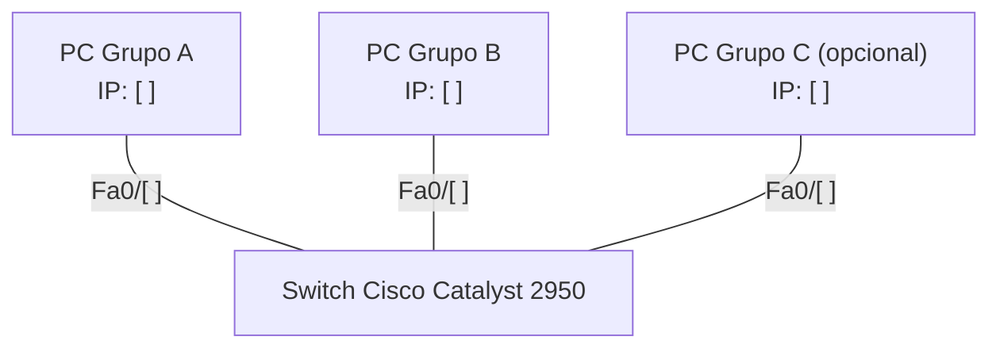

# UNIVERSIDAD NACIONAL DE CÓRDOBA

## FACULTAD DE CIENCIAS EXACTAS, FÍSICAS, Y NATURALES

### CÁTEDRA DE REDES DE COMPUTADORAS

**TRABAJO DE LABORATORIO Nro. 6**

**Alumnos:**

- Tosolini Franco Alberto (45702152)
- Scagliotti Marco (46070301)
- Barbero Giovanna Luz (46509956)
- von Büren Thomas (43136697)
- Prieto Quiroz Franco Manuel (46450221)
- Boyé Facundo (46070306)
- Frenguelli Guillermina (45154313)
- Arias valentin (45734482)

**Profesor:** Ingeniero Santiago Henn
**Comisión:** ICOMP24-03
**Año:** 2026

---

# PARTE 1: Taller de armado y verificación de cables Cat5/Cat5e (T568A/B)

## 1) Pasos para crimpar un cable derecho (no cruzado)

&nbsp;&nbsp;&nbsp;&nbsp;*[Breve introducción: qué es un cable de par trenzado Cat5/Cat5e, qué es la norma T568A/T568B y qué significa un cable "derecho" (mismo estándar en ambos extremos) frente a uno cruzado.]*

**Herramientas y materiales utilizados:**

* *[Cable Cat5/Cat5e, conectores RJ-45, pinza crimpeadora, pelacables, tester, etc.]*

**Orden de colores (norma elegida: T568A / T568B — indicar cuál):**

| Pin | Color del par (T568B) | Color del par (T568A) |
| :--- | :--- | :--- |
| 1 | Blanco/Naranja | Blanco/Verde |
| 2 | Naranja | Verde |
| 3 | Blanco/Verde | Blanco/Naranja |
| 4 | Azul | Azul |
| 5 | Blanco/Azul | Blanco/Azul |
| 6 | Verde | Naranja |
| 7 | Blanco/Marrón | Blanco/Marrón |
| 8 | Marrón | Marrón |

**Procedimiento paso a paso:**

1. *[Pelar la cubierta exterior (~2-3 cm).]*
2. *[Separar y destrenzar los pares.]*
3. *[Ordenar los hilos según la norma elegida.]*
4. *[Cortar a ras y emparejar los hilos.]*
5. *[Insertar en el conector RJ-45 (clip hacia abajo), verificando que lleguen al fondo.]*
6. *[Crimpar.]*
7. *[Repetir en el otro extremo con la MISMA norma.]*

*Fuente(s) consultada(s): [videos / tutoriales utilizados]*

---

## 2) Construcción del cable

&nbsp;&nbsp;&nbsp;&nbsp;*[Describir el cable construido por el grupo: longitud, norma utilizada, tipo (derecho), dificultades encontradas.]*


*Figura 1: Proceso de armado del cable.*


*Figura 2: Cable terminado (ambos extremos).*

---

## 3) Verificación del cable

&nbsp;&nbsp;&nbsp;&nbsp;*[Indicar qué grupo intercambió cables con el nuestro (ver punto 4).]*

**a) Inspección visual**


*Figura 3: Inspección visual del cable del otro grupo — extremo A.*


*Figura 4: Inspección visual del cable del otro grupo — extremo B.*

| Aspecto evaluado | ¿Bien / Mal? | Justificación |
| :--- | :--- | :--- |
| Orden de colores correcto según norma | *[ ]* | *[ ]* |
| Los 8 hilos llegan hasta el fondo del conector | *[ ]* | *[ ]* |
| La cubierta exterior ingresa en el conector (alivio de tensión) | *[ ]* | *[ ]* |
| Longitud de destrenzado (no excesiva) | *[ ]* | *[ ]* |
| Crimpado correcto (contactos hundidos, sin hilos sueltos) | *[ ]* | *[ ]* |
| Estado general del conector y del cable | *[ ]* | *[ ]* |
| Ambos extremos con la misma norma | *[ ]* | *[ ]* |

**b) Verificación eléctrica con tester**


*Figura 5: Verificación con tester de cables Ethernet.*

| Pin | LED tester (extremo local) | LED tester (extremo remoto) | ¿Continuidad correcta? |
| :--- | :--- | :--- | :--- |
| 1 | *[ ]* | *[ ]* | *[ ]* |
| 2 | *[ ]* | *[ ]* | *[ ]* |
| 3 | *[ ]* | *[ ]* | *[ ]* |
| 4 | *[ ]* | *[ ]* | *[ ]* |
| 5 | *[ ]* | *[ ]* | *[ ]* |
| 6 | *[ ]* | *[ ]* | *[ ]* |
| 7 | *[ ]* | *[ ]* | *[ ]* |
| 8 | *[ ]* | *[ ]* | *[ ]* |

**Conclusión de la verificación:** *[¿El cable es apto? ¿Se detectaron fallas (cortos, abiertos, pares cruzados)? ¿Qué se corregiría?]*

---

## 4) Documentación del intercambio de cables

| Cable verificado | Grupo que lo construyó | Grupo que lo verificó | Resultado visual | Resultado eléctrico |
| :--- | :--- | :--- | :--- | :--- |
| *[Nuestro cable]* | Nuestro grupo | *[Grupo X]* | *[ ]* | *[ ]* |
| *[Cable del grupo X]* | *[Grupo X]* | Nuestro grupo | *[ ]* | *[ ]* |


*Figura 6: Evidencia del proceso técnico de verificación con el otro grupo.*

---

# PARTE 2: Equipamiento físico, verificación y utilización de equipos de red y generación de tráfico

## Opcional

### 1) Características principales del switch Cisco Catalyst 2950

*[Resumen basado en el datasheet: cantidad y velocidad de puertos, capacidad de conmutación, tabla MAC, soporte de VLANs, puerto consola, etc.]*

| Característica | Valor |
| :--- | :--- |
| Modelo | Cisco Catalyst 2950 Series |
| Puertos | *[ ]* |
| Velocidad de los puertos | *[ ]* |
| Capacidad de conmutación | *[ ]* |
| Tamaño de tabla MAC | *[ ]* |
| Otras | *[ ]* |


*Figura 7: Panel frontal del switch (indicadores y puertos).*


*Figura 8: Panel trasero del switch (alimentación, puerto de consola).*

### 2) Checklists de procedimientos

**a) Conexión a la consola del switch (PuTTY, 9600 baudios)**

- [ ] *[Conectar cable serie/RJ-45 al puerto consola del switch.]*
- [ ] *[Conectar el adaptador serie-USB a la PC e identificar el puerto COM en el Administrador de dispositivos.]*
- [ ] *[Abrir PuTTY → Serial → COMx → Speed: 9600.]*
- [ ] *[Verificar acceso al prompt del switch.]*


*Figura 9: Acceso a la consola del switch mediante PuTTY.*

**b) Administración del switch y habilitación de interfaces**

- [ ] *[enable]*
- [ ] *[configure terminal]*
- [ ] *[interface fastEthernet 0/X]*
- [ ] *[no shutdown]*
- [ ] *[end / show interfaces status]*

```
(Pegar aquí la salida de consola relevante)
```

---

## Levantar y testear una LAN

### 1) Configuración manual de la interfaz de red

**Datos de la computadora utilizada:** *[Nombre / SO / interfaz]*

| Parámetro | Valor configurado |
| :--- | :--- |
| a) Dirección IPv4 | *[ ]* |
| b) Máscara de subred | *[ ]* |
| c) Default gateway | *[ ]* |


*Figura 10: Configuración manual de la interfaz de red.*

**d) Justificación de las direcciones elegidas:**

&nbsp;&nbsp;&nbsp;&nbsp;*[¿Por qué elegimos esas direcciones? ¿Pertenecen a un rango privado? ¿Están en la misma subred que las PCs de los otros grupos? ¿Tenía sentido configurar un gateway si no había router en la LAN? ¿Tenían o no sentido para la actividad?]*

---

### 2) Conexión al switch y prueba con ping

&nbsp;&nbsp;&nbsp;&nbsp;*[Indicar grupos que compartieron switch, puertos utilizados y estado de los LEDs.]*



*Figura 11: Topología de la LAN armada (completar IPs y puertos).*


*Figura 12: Ping exitoso hacia la PC de otro grupo.*

---

### 3) Receptor y emisor UDP con ncat

**Receptor:**

```
ncat -u -l 5000
```


*Figura 13: Receptor UDP escuchando en el puerto 5000.*

**Emisor:**

```
ncat -u [IP_receptor] 5000
```


*Figura 14: Emisor UDP enviando mensajes.*

---

### 4) Captura de paquetes UDP con Wireshark


*Figura 15: Captura general del tráfico UDP.*


*Figura 16: Detalle de un datagrama UDP (Ethernet / IPv4 / UDP / Data).*

| Capa | Origen | Destino | Campo relevante |
| :--- | :--- | :--- | :--- |
| **Ethernet II** | *[ ]* | *[ ]* | Type: *[ ]* |
| **IPv4** | *[ ]* | *[ ]* | Protocol: UDP (17) |
| **UDP** | Puerto: *[ ]* | Puerto: 5000 | Length: *[ ]* / Checksum: *[ ]* |
| **Datos** | N/A | N/A | *[Contenido del mensaje]* |

Se adjunta también el .pcapng de la prueba, titulado `[nombre_archivo].pcapng`.

---

### 5) Preguntas

**a) ¿Se observa algún procedimiento de establecimiento de conexión antes de enviar los datos?**

&nbsp;&nbsp;&nbsp;&nbsp;*[Respuesta, con referencia a la captura.]*

**b) ¿Existe algún mecanismo de confirmación de recepción equivalente a los ACK de TCP?**

&nbsp;&nbsp;&nbsp;&nbsp;*[Respuesta.]*

**c) ¿Qué ocurre si se envían mensajes mientras el receptor UDP no está ejecutándose?**

&nbsp;&nbsp;&nbsp;&nbsp;*[Respuesta. Indicar si apareció ICMP "Port unreachable" en Wireshark y adjuntar captura.]*


*Figura 17: Envío de mensajes UDP sin receptor activo.*

**d) ¿UDP garantiza que los mensajes lleguen en el mismo orden en que fueron enviados?**

&nbsp;&nbsp;&nbsp;&nbsp;*[Respuesta.]*

**e) ¿Qué aplicaciones reales utilizan UDP y por qué?**

&nbsp;&nbsp;&nbsp;&nbsp;*[Respuesta: ejemplos (DNS, VoIP, streaming, juegos online, DHCP, etc.) y justificación.]*

---

## Desarrollar un pequeño servidor

### 1) Directorio de archivos e inicio del servidor HTTP

**Archivos del directorio:**

| Archivo | Tipo |
| :--- | :--- |
| *[ ]* | TXT |
| *[ ]* | PDF |
| *[ ]* | Imagen |

```
python3 -m http.server 8000
```


*Figura 18: Servidor HTTP iniciado en la computadora servidora.*

### 2) Acceso desde el navegador


*Figura 19: Listado de archivos visto desde el navegador de la segunda computadora.*


*Figura 20: Descarga de un archivo desde el navegador.*

### 3) Transferencia con curl

```
curl -O http://[IP_servidor]:8000/[archivo]
```


*Figura 21: Descarga del archivo con curl.*

### 4) Captura de tráfico con Wireshark


*Figura 22: Captura general del tráfico generado (handshake TCP, GET, respuesta, cierre).*


*Figura 23: Detalle de la petición `GET` y la respuesta `200 OK`.*

**¿De qué tipo es el tráfico?**

&nbsp;&nbsp;&nbsp;&nbsp;*[Respuesta: protocolo de aplicación (HTTP), transporte (TCP), puerto utilizado, comparación con el tráfico UDP anterior, y si va en texto plano.]*

| Capa | Protocolo | Observación |
| :--- | :--- | :--- |
| Aplicación | HTTP | *[ ]* |
| Transporte | TCP | *[ ]* |
| Red | IPv4 | *[ ]* |
| Enlace | Ethernet II | *[ ]* |

---

## Restauración de la configuración de red

&nbsp;&nbsp;&nbsp;&nbsp;*[Confirmar que la interfaz de red volvió a configurarse para obtener dirección de forma automática (DHCP) y que hay acceso a Internet.]*


*Figura 24: Interfaz de red restaurada a configuración automática.*

---

## Conclusiones

&nbsp;&nbsp;&nbsp;&nbsp;*[Conclusiones generales del grupo: qué se aprendió de la capa física (cableado, switch), diferencias observadas entre UDP y TCP en la práctica, dificultades encontradas y cómo se resolvieron.]*
